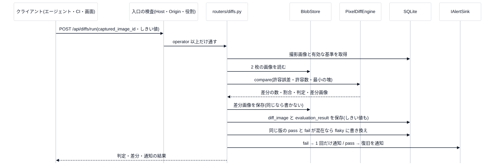

# 1. 全体像

## 何をするものか

**撮影した画像と、承認済みの基準画像を、ピクセルごとに比べ、違いがあれば知らせる**ビジュアル回帰ツールです。設計の軸は「**撮影を決定的に → 評価はシンプルなピクセル比較**」(講義[第 0 回](../lecture/00-introduction.md))。

| 領域 | 場所 | 技術 |
|---|---|---|
| バックエンド | `backend/app/` | Python 3.12・FastAPI・SQLite・Pillow・NumPy・SciPy |
| フロントエンド | `frontend/src/` | React 19・TypeScript・Vite |
| 撮影エージェント(Python) | `capture_agents/` | Houdini 向け+共通の契約・決定性の検収・CI 用スクリプト |
| 撮影エージェント(C#) | `unity_capture_agent/` | Unity 向け(**このリポジトリ内では未検証**) |

担当範囲は、設計の **Phase 3〜5**(基準と差分評価・DB・アラートと画面)。決定的な撮影(Phase 1〜2)は撮る側の仕事です。

## 1 回の差分実行(シーケンス)

## 状態の置き場所

| 何を | どこに | 備考 |
|---|---|---|
| 指示・撮影・基準・差分・判定・通知の記録 | SQLite(`VRQA_DB_PATH`・既定 `backend/data/vrqa.sqlite3`) | 鎖の外部キーはすべて `NOT NULL` |
| 画像(撮影・差分) | `VRQA_BLOB_ROOT`(既定 `backend/data/blobs`)。名前は SHA-256 | DB と同じ永続ボリュームに置く |
| 通知のトースト | **メモリ**(`webui_toast`) | 再起動で消える。画面が `?since_id=` で取りに来る |
| ユーザー(キーのハッシュ) | `VRQA_AUTH_FILE`(既定 `backend/data/auth_users.json`) | Git に入れない |
| 監査ログ | `VRQA_AUDIT_LOG`(既定 `backend/data/audit.jsonl`) | 5 MB で `.1` に退避 |

## 設定(環境変数・主なもの)

全部の表は [旧 README の詳細](../reference/setup-and-operations.md)。

| 名前 | 既定 | 意味 |
|---|---|---|
| `VRQA_DB_PATH`・`VRQA_BLOB_ROOT` | `backend/data/...` | DB と画像の場所 |
| `VRQA_CORS_ORIGINS` | `localhost:5173` など | UI の配信元(`*` は**拒否**) |
| `VRQA_ALLOWED_HOSTS` | ループバックのみ | API を開くホスト名(DNS rebinding 対策。認証ではない) |
| `VRQA_AUTH` | `off` | `required` で API キー必須(ユーザーが 0 人なら起動しない) |
| `VRQA_ALERT_SINK` | `noop` | `webhook`・`github`・`webui_toast`・`composite` |
| `VRQA_DEBUG` | 無効 | しきい値ラボ・連続性の検査を、本番でも有効にする(admin だけ) |
| `VRQA_API_KEY` | なし | 撮影エージェントが `X-API-Key` に付けるキー |

## 主な API

| 場所 | 役割 | 最低の役割 |
|---|---|---|
| `POST /api/instructions`・`GET` | 撮影指示の作成・一覧 | operator・viewer |
| `POST /api/captures`(画像) | 撮影画像のアップロード(PNG に正規化して保存) | operator |
| `DELETE /api/captures/{id}` | 撮影画像の削除(基準・差分履歴にあるものは 409) | **admin** |
| `POST /api/references/promote`・`GET /api/references/active/{instruction_id}` | 撮影画像を基準へ昇格・有効な基準の取得 | **admin**・viewer |
| `POST /api/diffs/run`・`/run-batch` | 差分実行(単発・一括) | operator |
| `POST /api/diffs/preview` | しきい値ラボ(**何も保存しない**) | **admin**・`VRQA_DEBUG` |
| `POST /api/analysis/continuity` | フレーム連続性の検査 | **admin**・`VRQA_DEBUG` |
| `GET /api/runs`・`/api/runs/dashboard`・`/api/runs/first-bad-commit/{instruction_id}` | 履歴・画面一覧・最初に壊れた版 | viewer |
| `GET /api/alerts/toasts` | 画面のトースト | viewer |
| `GET /api/health` | 疎通確認(認証なし) | – |

`VRQA_AUTH=off` のときは、全員が admin 扱いです。
